# Urban Scooter: courier Android app

A TripleTen QA Engineer Bootcamp project. In the courier app, couriers log in and see two tabs: "All orders" (not yet accepted) and "My orders". From there they can pull to refresh, sort by delivery date with overdue orders on top, filter by metro station, and accept and complete orders.

## What I tested

The order list, the order cards (short and full versions), the station filter, accepting and completing orders, login and logout, and persistence after the app is killed. Everything ran on the Android Studio emulator, with test data created through the app's API.

- **Techniques:** requirement-based test design, state checks across tabs, negative cases (invalid login, empty states).
- **Evidence:** screenshots of the key screens and of the defects (gallery below).

**35 test cases** · 20 passed · 7 failed · 8 inconclusive

- [Test cases](test-cases.md)

### Evidence gallery

Screenshots reviewed one by one. They are shown by what they prove, not linked to case IDs.

| | | |
|---|---|---|
| 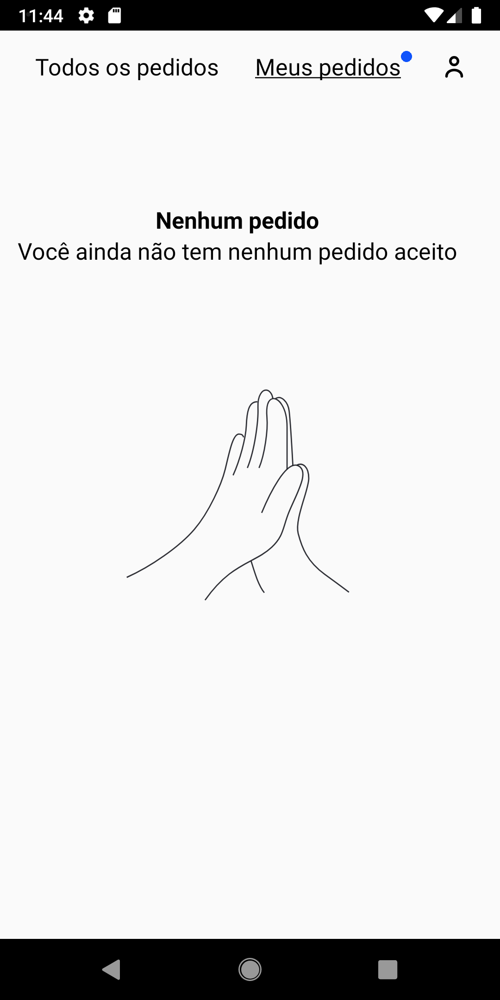 My orders: empty state | 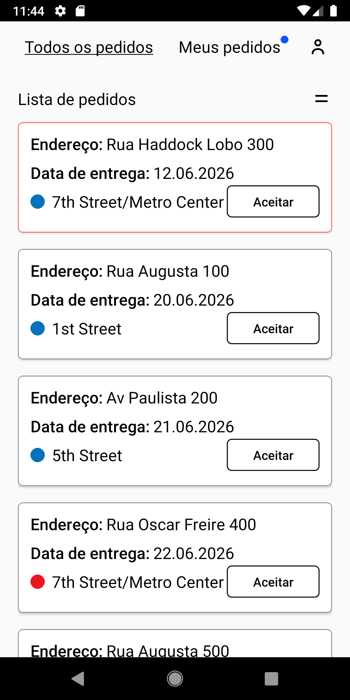 All orders: the overdue order is on top, with a red border | 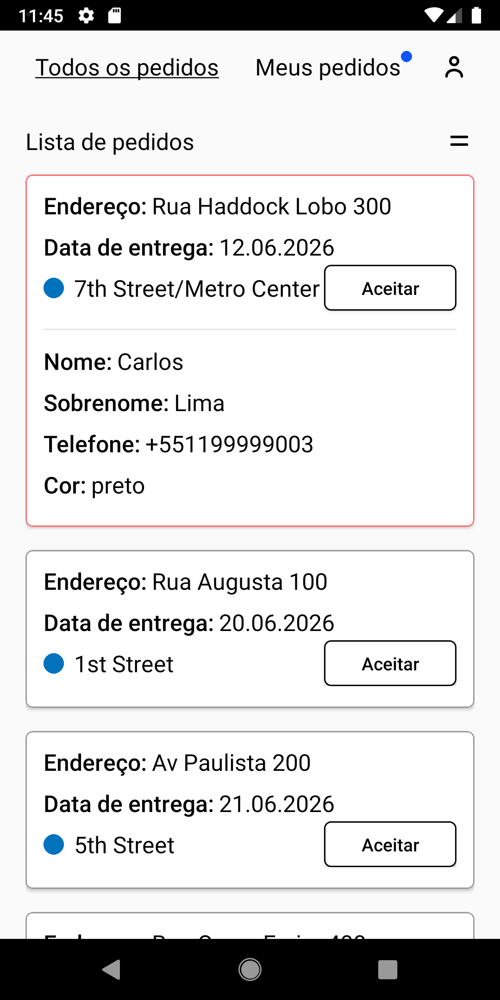 Full card: name, surname, phone and scooter colour |
| 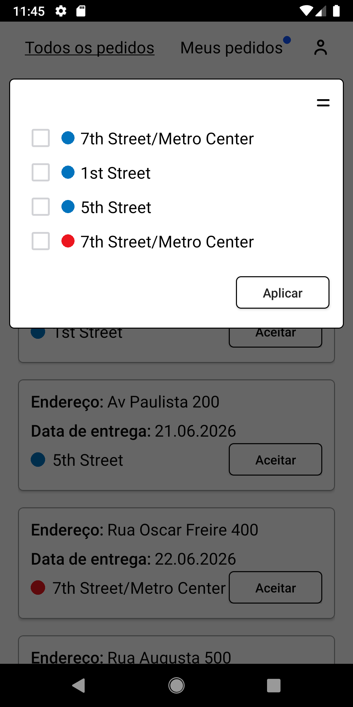 Metro-station filter | 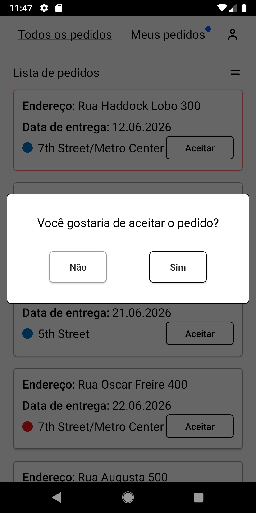 Accepting an order: confirmation dialog | 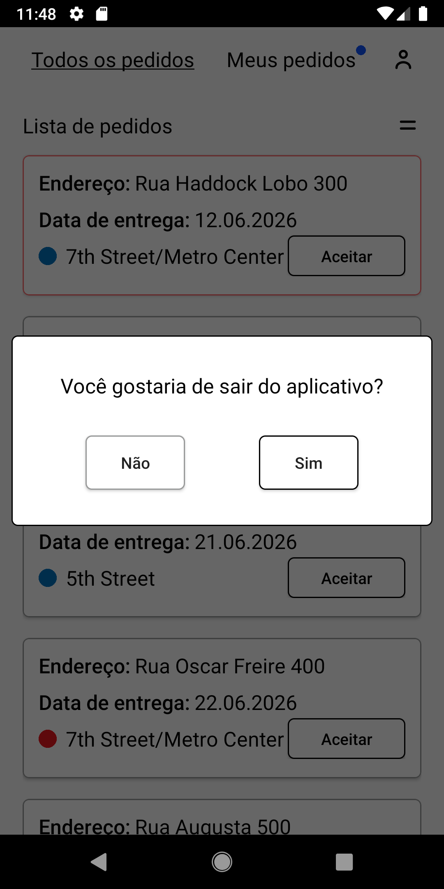 Logging out: confirmation dialog |
| 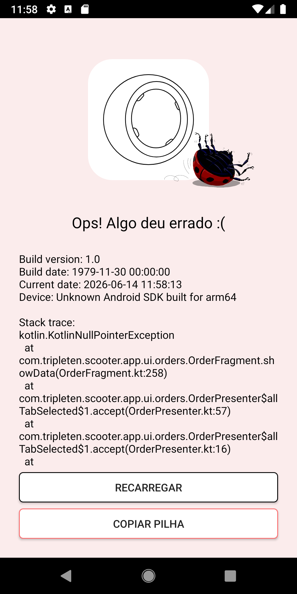 Defect: crash (KotlinNullPointerException) when the My orders tab renders | 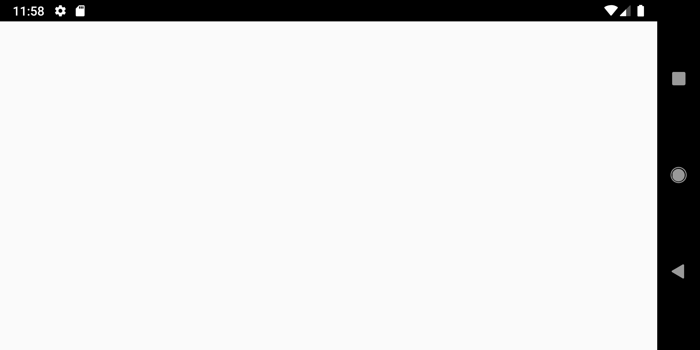 Defect: rotating to landscape leaves a blank screen | 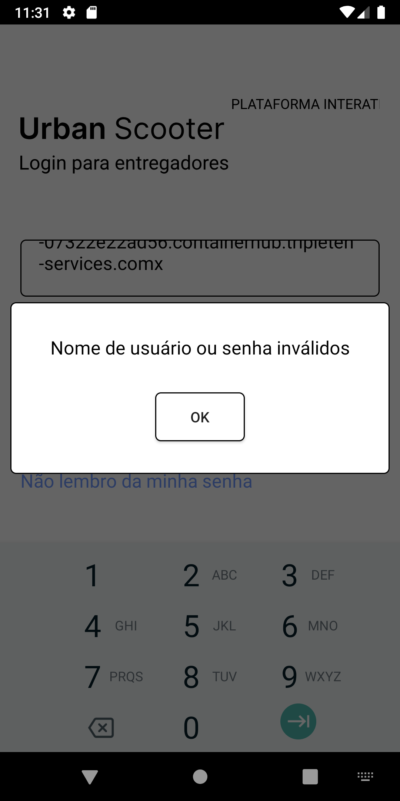 Invalid login: error message |
| 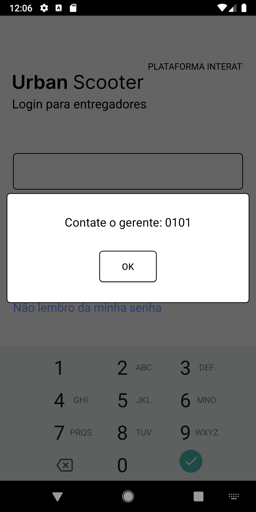 Forgot password: "Contact the manager: 0101" | 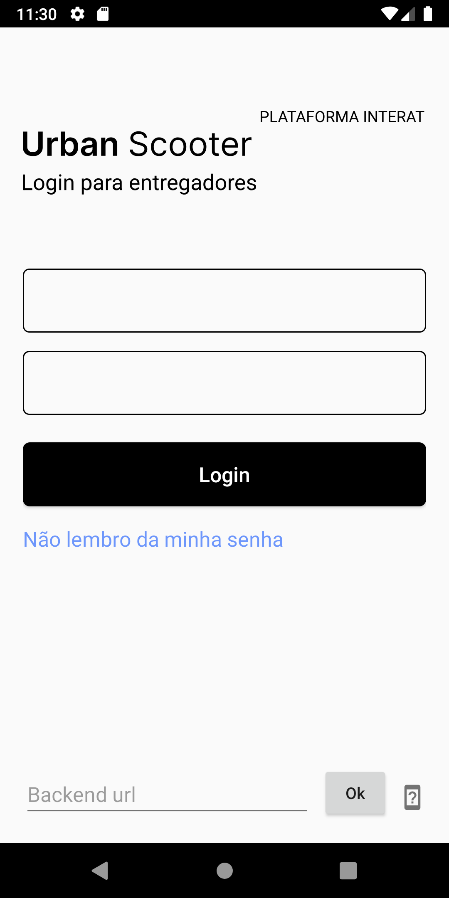 Backend URL setting for the test environment | 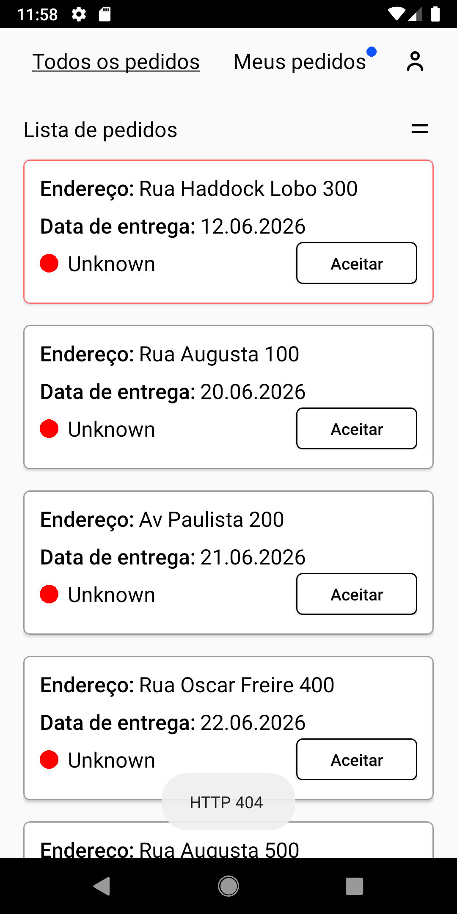 Defect: after the app is killed, stations show "Unknown" and an HTTP 404 appears |

Cases are in Portuguese, as written during the bootcamp.

[← Back to the portfolio](../../README.md)
