# Urban Scooter (web) · bug reports

Test cases are kept in their original language (Portuguese).

### Bug 1: O campo "Telefone" permite o preenchimento sem o símbolo obrigatório "+"

**Priority:** High · **Type:** Bug · **Environment:** Chrome / Opera (1280x720)

Pré-condições: Servidor Urban Scooter iniciado na resolução 1280x720.

Passos para reproduzir:
1. Clique em "Fazer pedido".
2. No campo "Telefone", digite um número com 11 dígitos, mas sem o sinal de mais (ex: 12345678901).
3. Clique fora do campo.

Resultado Esperado: Borda vermelha e exibição da mensagem de erro "Digite um número válido".
Resultado Real: Nenhuma validação ocorre. O campo aceita a entrada e não exibe erros.

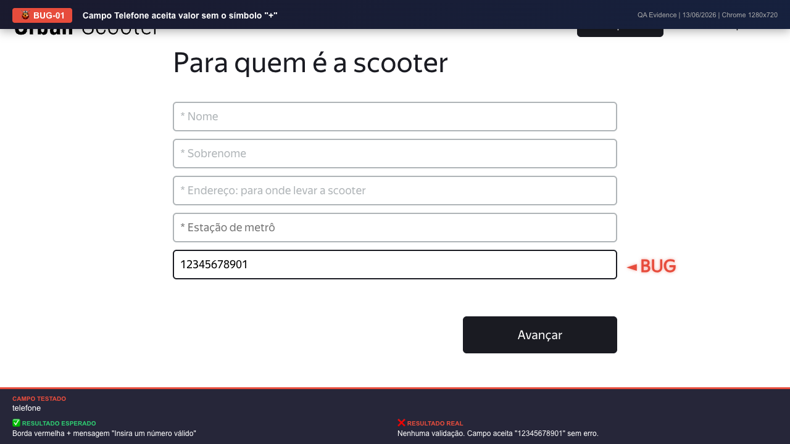

### Bug 2: O campo "Telefone" permite a inserção de letras

**Priority:** High · **Type:** Bug · **Environment:** Chrome / Opera (1280x720)

Pré-condições: Servidor Urban Scooter iniciado na resolução 1280x720.

Passos para reproduzir:
1. Clique em "Fazer pedido".
2. No campo "Telefone", digite letras misturadas (ex: +123456789A).
3. Clique fora do campo.

Resultado Esperado: Borda vermelha e exibição da mensagem de erro "Digite um número válido".
Resultado Real: O campo aceita letras livremente sem retornar nenhuma mensagem de erro.

### Bug 3: O campo "Telefone" permite a inserção de espaços

**Priority:** High · **Type:** Bug · **Environment:** Chrome / Opera (1280x720)

Pré-condições: Servidor Urban Scooter iniciado na resolução 1280x720.

Passos para reproduzir:
1. Clique em "Fazer pedido".
2. No campo "Telefone", digite um número contendo espaços (ex: +123 456 789).
3. Clique fora do campo.

Resultado Esperado: Borda vermelha e exibição da mensagem de erro "Digite um número válido".
Resultado Real: O campo não higieniza os espaços nem exibe erro visual. Permite avançar.

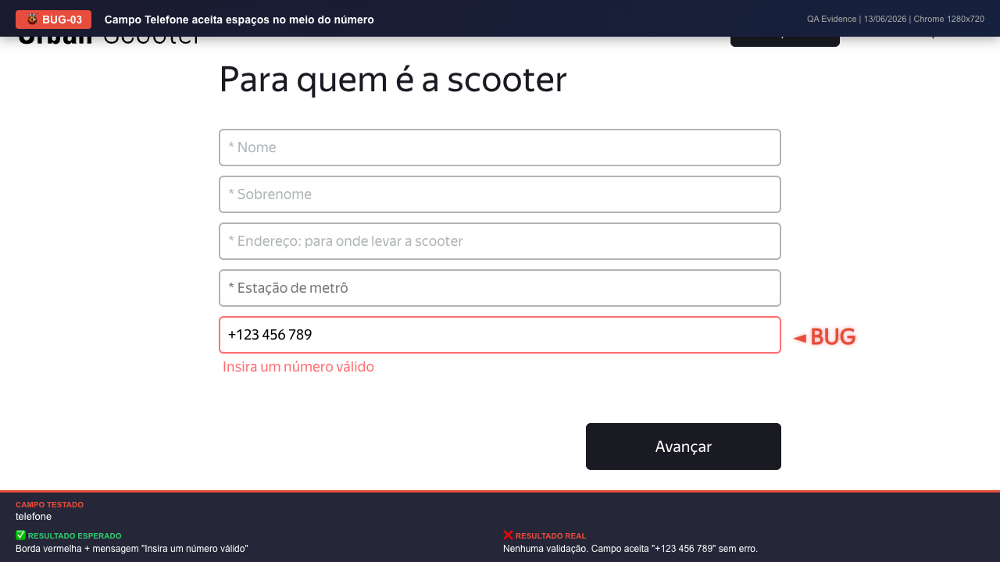

### Bug 4: Texto da mensagem de erro incorreto ao inserir endereço com menos de 5 caracteres

**Priority:** Low · **Type:** Bug · **Environment:** Chrome / Opera (1280x720)

Pré-condições: Servidor Urban Scooter iniciado na resolução 1280x720.

Passos para reproduzir:
1. Clique em "Fazer pedido".
2. No campo "Endereço", digite menos de 5 caracteres (ex: Rua ).
3. Clique fora do campo.

Resultado Esperado: Exibir uma mensagem informando que o endereço é muito curto ou inválido.
Resultado Real: O campo exibe a mensagem de erro literal "Digite um número válido", o que confunde o usuário que está inserindo um logradouro.

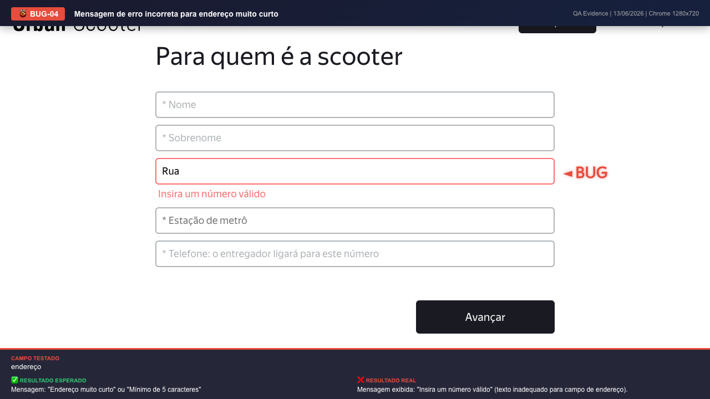

### Bug 5: Texto da mensagem de erro incorreto ao exceder 50 caracteres no Endereço

**Priority:** Low · **Type:** Bug · **Environment:** Chrome / Opera (1280x720)

Pré-condições: Servidor Urban Scooter iniciado na resolução 1280x720.

Passos para reproduzir:
1. Clique em "Fazer pedido".
2. No campo "Endereço", digite mais de 50 caracteres.
3. Clique fora do campo.

Resultado Esperado: O sistema deve impedir a digitação ou exibir mensagem indicando que o limite foi excedido.
Resultado Real: A mensagem exibida é genérica e incorreta: "Digite um número válido".

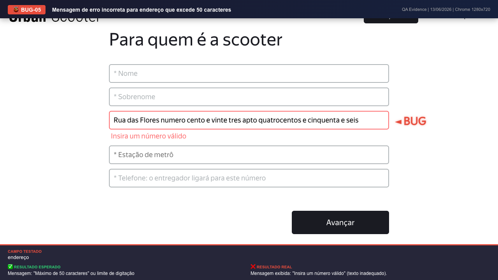

### Bug 6: Texto da mensagem de erro incorreto ao inserir caracteres especiais no Endereço

**Priority:** Low · **Type:** Bug · **Environment:** Chrome / Opera (1280x720)

Pré-condições: Servidor Urban Scooter iniciado na resolução 1280x720.

Passos para reproduzir:
1. Clique em "Fazer pedido".
2. No campo "Endereço", digite símbolos não permitidos (ex: Rua @).
3. Clique fora do campo.

Resultado Esperado: Exibir mensagem indicando que foram usados caracteres inválidos no endereço.
Resultado Real: O campo dispara a mensagem incorreta: "Digite um número válido".

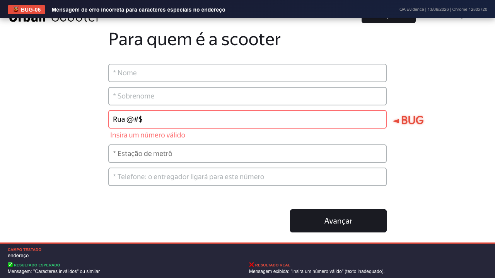

### Bug 7: Texto da mensagem de erro incorreto ao deixar o campo Endereço vazio

**Priority:** Medium · **Type:** Bug · **Environment:** Chrome / Opera (1280x720)

Pré-condições: Servidor Urban Scooter iniciado na resolução 1280x720.

Passos para reproduzir:
1. Clique em "Fazer pedido".
2. Deixe o campo "Endereço" vazio e clique no botão "Avançar".

Resultado Esperado: A mensagem deveria informar que o campo "Endereço" é obrigatório.
Resultado Real: A validação retorna mais uma vez o texto genérico "Digite um número válido".

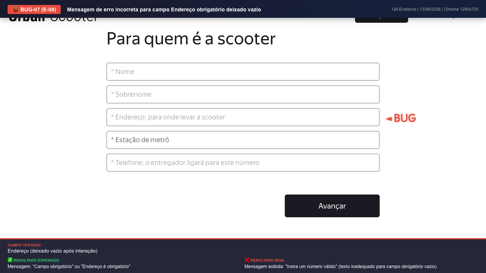

## Additional findings (evidence only)

**Bug8 Nome Acentuado Erro**

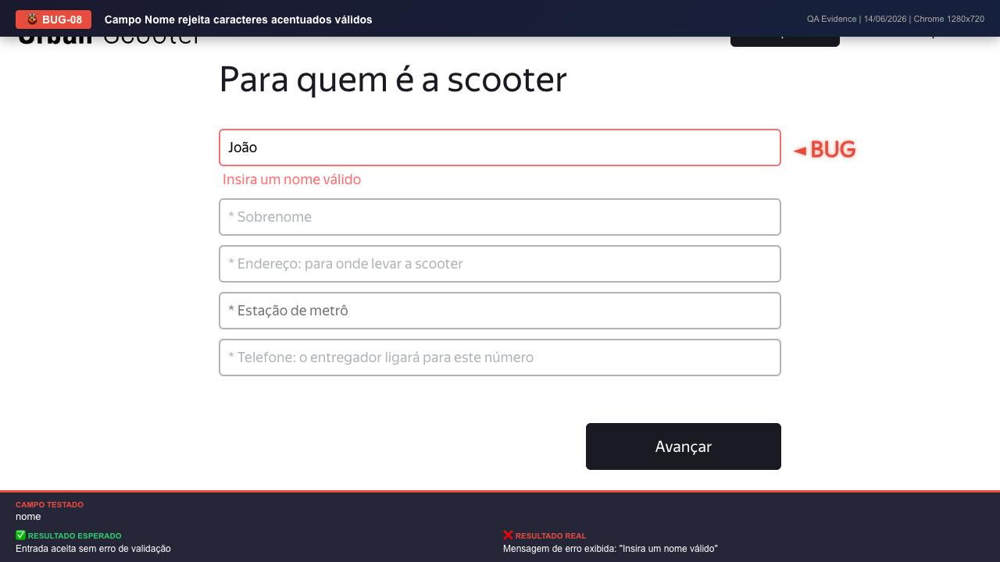

**Bug9 Nome Apenas Espacos Aceito**

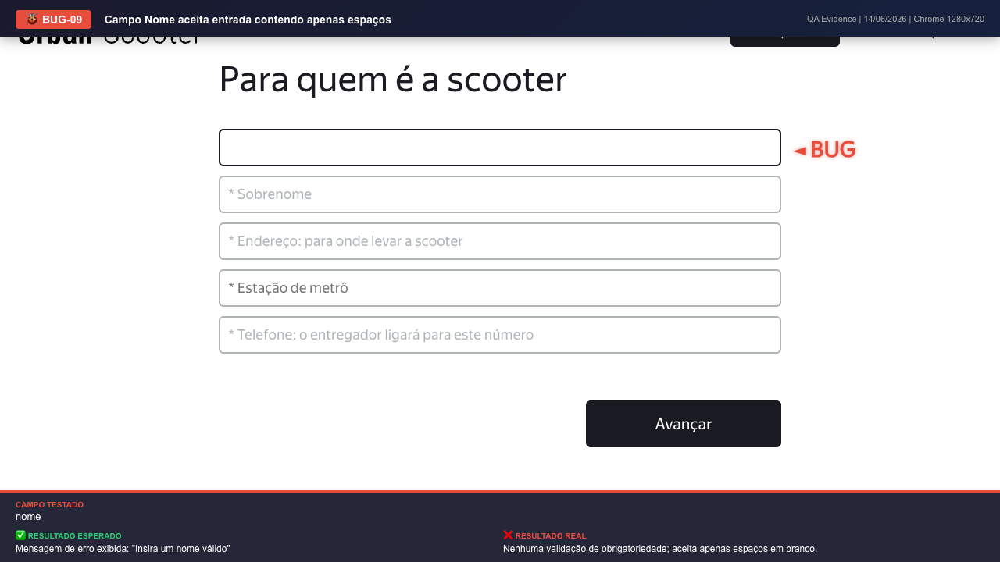

**Bug10 Sobrenome Acentuado Erro**

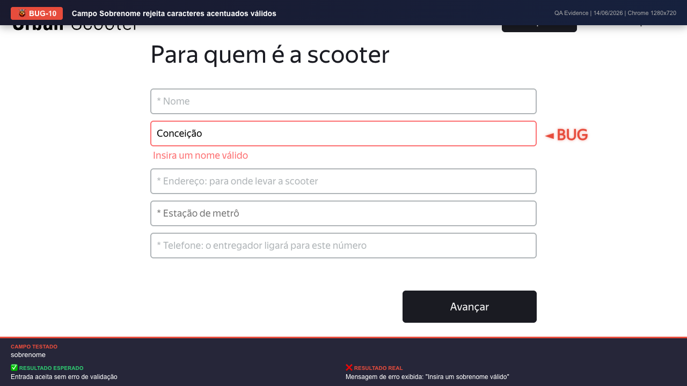

**Bug11 Endereco Acentuado Erro**

**Bug12 Telefone Internacional Erro**

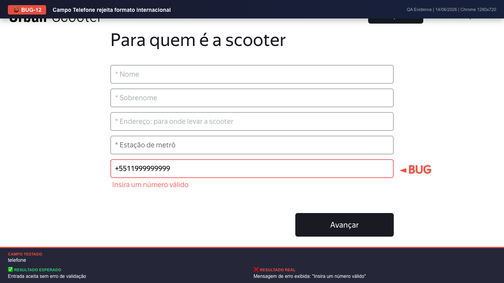

**Bug13 Endereco Trim Mensagem Incorreta**

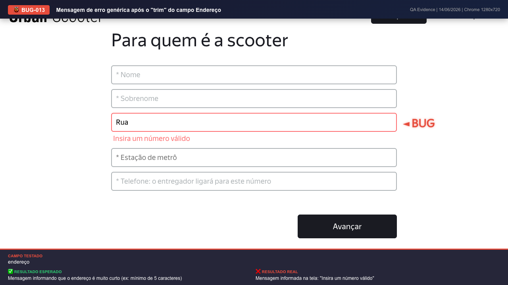

[← Project](README.md)
